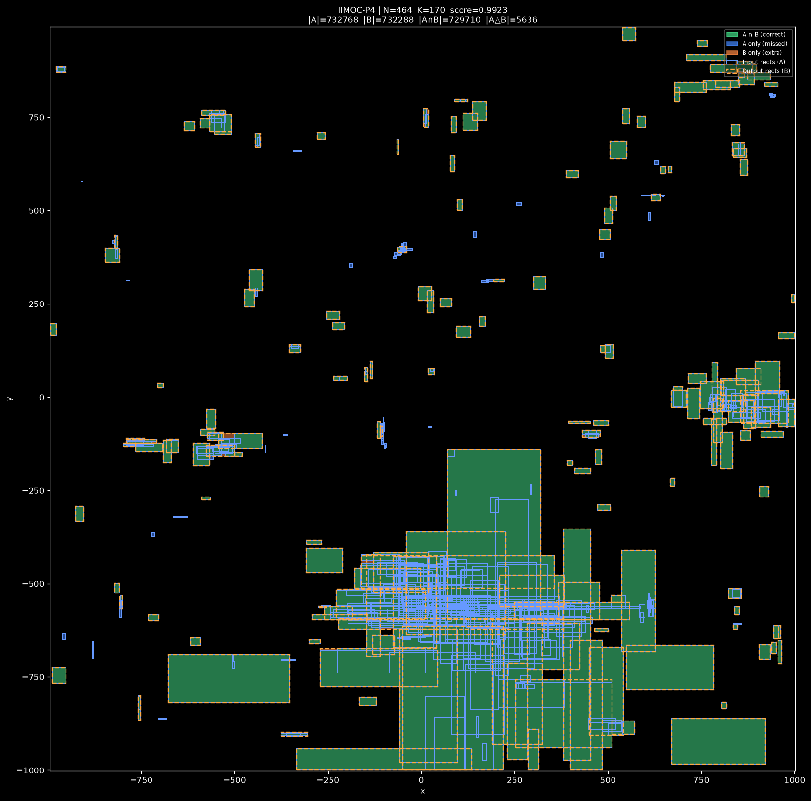
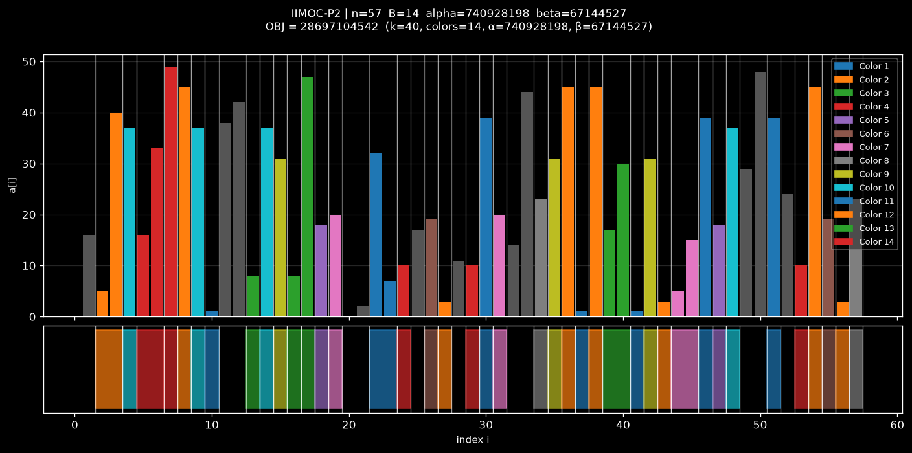

# IIMOC-2026

Solutions to two heuristic optimization problems from IIMOC 2026.

| Problem | Score | Raw |
| --- | --- | --- |
| Rectangle Approximation | 99.23% | 388.673589 |
| Chromatic Block Harmony | 99.88% | 800425419096089 |

Total: 199.107

## Usage

```
python3 square_approximation.py < squareapproximation/smalltest/1.in
python3 block_harmony.py < blockharmony/smalltest/1.in
```

Judge cases: `python3 gen.py 42 <1-30>` inside a problem folder.
Render: `python3 vis.py case.in case.out --out case.png` (needs matplotlib, numpy).

## Files

```
square_approximation.py   Rectangle Approximation
block_harmony.py          Chromatic Block Harmony
squareapproximation/      statement, generator, visualizer, samples
blockharmony/             same
viz/                      rendered outputs
```

## Rectangle Approximation

Output exactly K rectangles approximating the union A of N input rectangles.
Score: `1 - |A xor B| / |A|`.

- **Clustering**: union-find splits the input into independent components.
- **Coordinate compression**: grids use only the input's x and y values.
- **Build-up**: greedily add the largest rectangle fully inside A. Faster and better than allowing excess (2D Kadane).
- **Budget**: heap over per-cluster marginal gains, no minimum per cluster.
- **Drop-down**: start from the input and remove the cheapest rectangle; keep whichever approach wins.
- **Edge sliding + relocation**: alternate until time runs out, applying only improving moves.
- If K >= N, print the input.

Local average 0.9693 (seed 42, cases 1–30), slowest case 1.31s of 5s.



Green: covered. Blue: missed. Orange: excess.

## Chromatic Block Harmony

Pick non-overlapping blocks and color them so same-colored blocks have equal sums.
Maximize `alpha * k - beta * C`.

A color is just a sum, so choose at most B sums, then pack blocks by greedy interval scheduling.

- **Candidates**: array values plus frequent window sums (length 2–20), ranked by greedy block count.
- **Phase 1**: single elements only, chosen by frequency.
- **Phase 2**: add colors greedily, merging block lists incrementally.
- **Phase 3**: swap refinement, capped at 2.4s of 3s.


